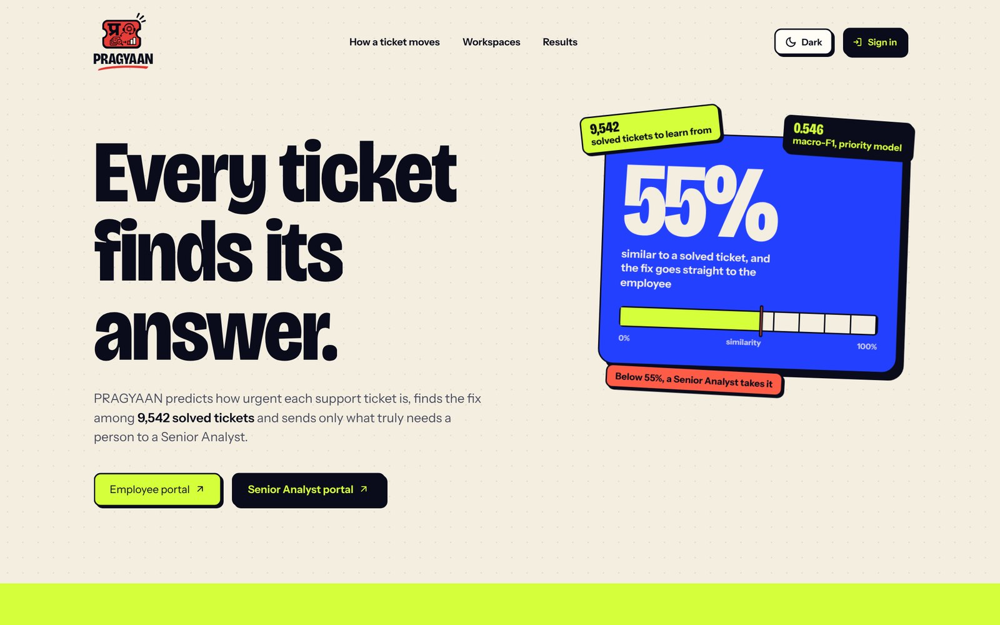
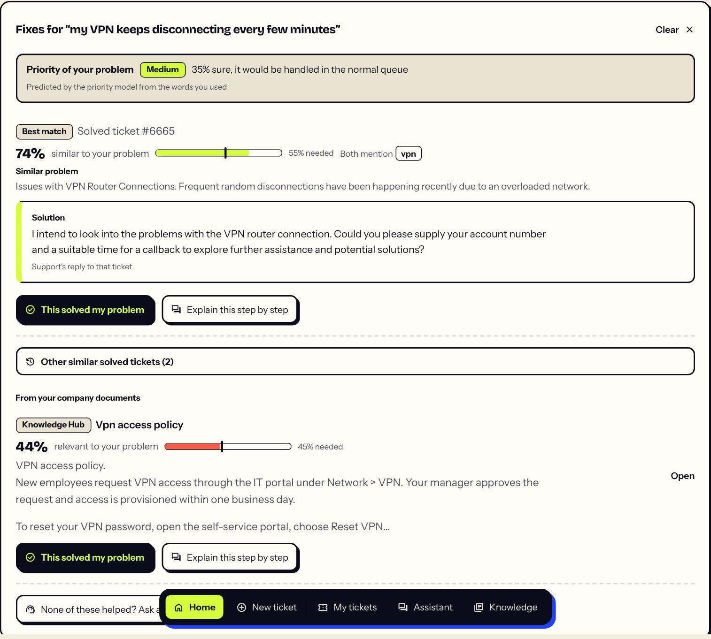
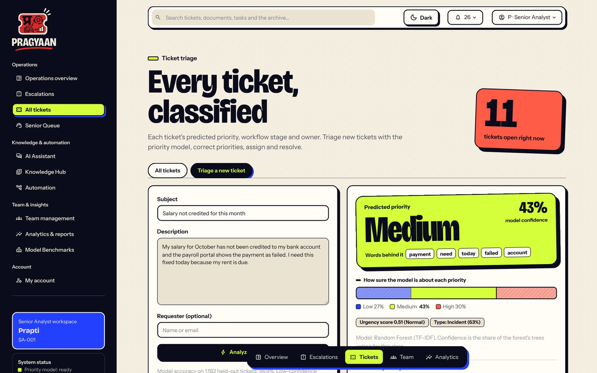
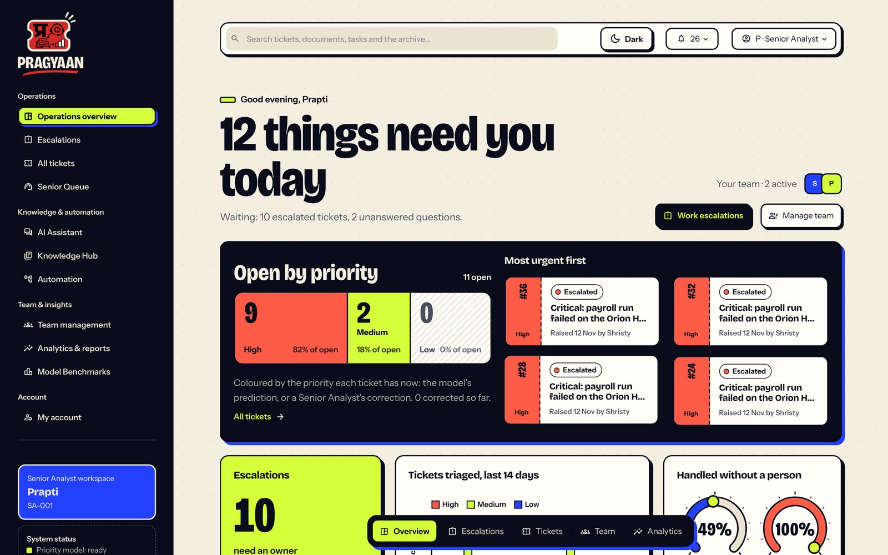
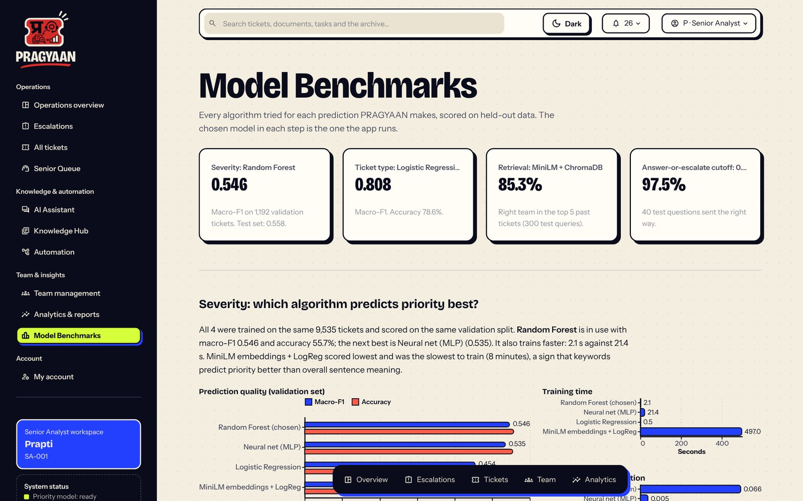

# PRAGYAAN – Onboarding Knowledge Copilot for Support Ticket Triage

**PRAGYAAN predicts how urgent a support ticket is, shows the closest ticket that has already been solved together with its fix, and sends the question to a Senior Analyst only when no reliable answer exists.**

Machine Learning project (21CSC305P) · B.Tech Computer Science Engineering · SRM Institute of Science and Technology, Kattankulathur



## Team

| Name | Register No. |
|---|---|
| Prapti Priya | RA2411003012115 |
| Sai Santosh Preetam | RA2411003012120 |
| Ipshita Sharma | RA2411003012134 |
| Shristy Shree | RA2411003012139 |

**Faculty guide:** Dr. Subalalitha C N, Professor, Department of Computing Technologies, SRM Institute of Science and Technology.

## The problem

New employees ask questions that have usually been solved before, and every repeat lands on a senior analyst who has to find the old answer again. At the same time, a genuinely urgent ticket (a payroll run that failed, a system that is down) waits in the same queue as a password reset. PRAGYAAN learns from past tickets to do three things:

1. **Rate the priority** of a new ticket (high, medium or low) so urgent ones are seen first.
2. **Reuse solved tickets**: if a past ticket is similar enough, its solution is shown straight away.
3. **Escalate only when needed**: questions with no reliable match go to a Senior Analyst, and the answer is added to the knowledge base so the next person gets it instantly.

## What the app does

| Employee portal | Senior Analyst portal |
|---|---|
| **Find a fix**: type a problem, see its predicted priority, the closest solved ticket with its solution and why it matched; close it with *This solved my problem* or ask for a step-by-step explanation | **Overview**: open work by priority, queues, trends and items needing attention |
| **Submit a ticket** with an instant priority prediction and recommended solutions | **Escalations**: tickets with no close match, ordered by predicted priority, to assign or resolve |
| **My tickets**: track, confirm or reopen | **Smart Triage**: Random Forest priority with class probabilities, signal words and similar past tickets; analysts can correct the priority |
| **AI Assistant**: a company-only chat assistant (generative AI via Groq) that explains, answers follow-up questions, drafts emails and summarises documents | **Senior Queue, Knowledge Hub, Automation, Team management, Analytics, Model Benchmarks** |

| Find a fix | Smart Triage |
|---|---|
|  |  |
| **Analyst overview** | **Model Benchmarks** |
|  |  |

## How the machine learning fits together

```
ticket text ──► cleaning ──► TF-IDF (1–2 grams) ──► Random Forest ──► priority: high / medium / low
     │
     └────────► MiniLM sentence embedding ──► ChromaDB nearest solved tickets
                                                   │
                                     similarity ≥ 0.55 ?
                                       ├── yes ──► show the solved ticket and its fix
                                       └── no  ──► escalate to a Senior Analyst ──► answer added to the knowledge base
```

A Logistic Regression model labels the ticket type (incident, request, problem, change). The AI Assistant is the generative layer: a language model on Groq writes the replies from the company's documents and past cases; it never changes a score, priority or route.

## Dataset

[Multilingual Customer Support Tickets](https://www.kaggle.com/datasets/tobiasbueck/multilingual-customer-support-tickets) (Kaggle), English subset: **9,535 development tickets** with subject, body, priority, type, queue and the agent's answer. Stratified 80/20 split (7,628 train / 1,907 test, seed 42). Unit 4 uses the same tickets as word sequences.

## ML coursework (Units 1–5)

| Unit | Topic | What we did | Notebook |
|---|---|---|---|
| 1–2 | Fundamental ML | EDA, cleaning, TF-IDF; Logistic Regression, Naive Bayes, linear SVM, k-NN, MLP with cross-validated tuning | [`Unit1_2_Classification.ipynb`](notebooks/Unit1_2_Classification.ipynb) |
| 3 | Unsupervised learning | PCA, truncated SVD, K-Means and agglomerative clustering, t-SNE, nearest-neighbour retrieval and the 0.55 threshold | [`Unit3_4_Clustering_and_HMM.ipynb`](notebooks/Unit3_4_Clustering_and_HMM.ipynb) |
| 4 | Sequential modelling | Markov chain and hidden Markov model classifiers with Viterbi decoding on ticket word sequences | same notebook |
| 5 | Ensemble learning | CART, Random Forest, AdaBoost, XGBoost and a soft-voting ensemble | [`Unit5_Ensemble_Learning.ipynb`](notebooks/Unit5_Ensemble_Learning.ipynb) |

All notebooks are also on [Google Colab](https://colab.research.google.com/drive/15HuHDw7ECVTomOBJ-nf5GZK-hi4uXIW6?usp=sharing).

### Results (priority prediction, 1,907 unseen test tickets)

| Model | Unit | Accuracy | Macro-F1 |
|---|---|---|---|
| Majority-class baseline | – | 41.5% | 0.196 |
| Logistic Regression | 1 | 47.5% | 0.464 |
| Multinomial Naive Bayes | 1 | 49.0% | 0.392 |
| Linear SVM | 2 | 48.0% | 0.456 |
| k-NN (cosine, TF-IDF) | 2 | 61.2% | 0.590 |
| MLP (128-64) | 2 | 55.8% | 0.536 |
| Markov chain on word sequences | 4 | 54.6% | 0.523 |
| HMM (per class, Viterbi) | 4 | 43.6% | 0.406 |
| CART | 5 | 45.5% | 0.440 |
| **Random Forest (deployed)** | 5 | 57.8% | 0.559 |
| AdaBoost | 5 | 48.4% | 0.359 |
| XGBoost | 5 | 53.3% | 0.511 |
| Soft-voting ensemble (LR + RF + XGBoost) | 5 | 55.2% | 0.532 |

- **Answer reuse:** at a 0.55 similarity threshold, PRAGYAAN made the right reuse-or-escalate decision **97.5%** of the time.
- **Clustering** recovered ticket types (NMI 0.32) but not urgency, and word order helps: the Markov chain beat an order-free model.
- **Why ~58% and not 90%+?** Priority labels are partly subjective: even near-identical tickets (similarity ≥ 0.90) carry the same priority only 89% of the time. That ceiling is why PRAGYAAN treats the predicted priority as a suggestion that analysts can correct, and why reusing similar solved tickets is its strongest signal. k-NN scored highest on macro-F1 (0.59); the Random Forest (0.56) was deployed because it is fast, stable and explains its decisions through feature importance.

## Run it (Windows)

Double-click **`run_project.bat`** in this folder. It installs anything missing, starts the app and opens **http://localhost:8501**. Or by hand from this folder:

```powershell
python -m pip install -r requirements.txt --find-links wheels
python -m streamlit run app\Home.py
```

Always start from the project root so `.streamlit/config.toml` (theme and bundled fonts) is picked up.

- **Works without any key:** priority prediction, ticket type, semantic search, Find a fix, escalations, automation, analytics and benchmarks.
- **AI Assistant:** add `GROQ_API_KEY` to a `.env` file (see `.env.example`). Without a key the assistant shows the closest real passage or past answer and says the language model is not connected; nothing is made up.

**Creating accounts (no default passwords).** Either open the app on the computer running it while no Senior Analyst exists and use *Set up the first Senior Analyst*, or run on the server:

```powershell
..\.venv\Scripts\python scripts\create_account.py create --role analyst --id SA-001 --name "Your Name"
..\.venv\Scripts\python scripts\create_account.py reset --id SA-001   # recover a locked-out analyst
..\.venv\Scripts\python scripts\create_account.py list
```

The password is typed at a hidden prompt. After that, Senior Analysts add everyone else in **Team management** (a one-time temporary password is generated and must be changed at first sign-in). *Forgot password?* sends a request to the Senior Analysts, who issue a temporary password from Team management. Accounts from the earlier e-mail sign-in were carried over automatically: administrators became Senior Analysts, other users Employees; they sign in with their old e-mail as ID and their old password, and a Senior Analyst can give them a proper ID in Team management.

**Notebooks:** open them in Google Colab (or Jupyter), upload `notebooks/data/tickets.parquet` and `notebooks/data/emb.npy` (plus the two CSV files for Unit 3) when asked, and run all cells. Extra libraries: `pip install -r notebooks/requirements-notebooks.txt`.

**Tests:** `python -m pytest -v`

## Accounts and roles

| | Employee | Senior Analyst |
|---|---|---|
| Signs in at | Employee portal, with an Employee ID | Senior Analyst portal, with a Senior Analyst ID |
| Tickets | Submits tickets; closes them when a recommended solution or an answer works, or escalates; sees tickets they raised or that are assigned to them; works and resolves assigned tickets | Sees all tickets; works escalations; assigns, resolves, reopens; corrects priorities; sees self-resolved tickets |
| Other pages | AI Assistant, Knowledge Hub (read), Search, My account | Everything, plus Senior Queue, Automation, Team management, Analytics, Model Benchmarks |

**Security.** Passwords are salted PBKDF2-SHA256 hashes (200,000 iterations). The ID is checked against the portal's role on the server, with the same message for unknown IDs and wrong passwords. Five failed attempts lock an account for 5 minutes. Sessions are random tokens stored only as SHA-256 hashes; they expire after 12 hours (30 days with Remember me) and are revoked on sign-out, password change, reset, role change or deactivation. Every run re-validates the session, only the pages for the account's role are registered (typing another role's URL lands on your home page), and each role-specific page re-checks the role. The session cookie is `SameSite=Strict`; Streamlit can't set `HttpOnly` cookies from Python, which is why the server-side revocation matters.

## Repository structure

```
Pragyaan/
├── README.md
├── requirements.txt       # app dependencies
├── run_project.bat        # one-click start on Windows
├── app/                   # Streamlit app: Home.py router, views/ pages, ui.py design
├── src/copilot/           # triage, retrieval, assistant, explanations, sign-in, database
├── data/                  # processed ticket archive and ChromaDB index
├── models/                # trained Random Forest (priority) and intent models
├── notebooks/             # Unit 1–5 notebooks and their data
├── eval/results/          # benchmarks, threshold sweep, confusion matrices
├── scripts/               # data preparation, training, evaluation, account tools
├── docs/screenshots/      # images used in this README
└── tests/                 # automated tests
```

## Tech stack

Python · scikit-learn · XGBoost · hmmlearn · sentence-transformers (all-MiniLM-L6-v2) · ChromaDB · Streamlit · SQLite · Groq LLM API · pandas · matplotlib

## Acknowledgements

We thank our guide **Dr. Subalalitha C N**, Department of Computing Technologies, SRM Institute of Science and Technology, for her guidance and support, and Tobias Bueck for publishing the ticket dataset on Kaggle.
